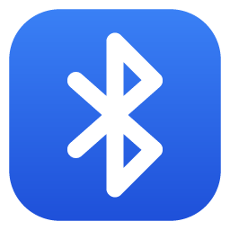

<div align="center">



# Bluetooth+ para Windows

**Um jeito mais bonito e mais útil de gerenciar o Bluetooth no Windows.**
Radar de proximidade, ícone para cada tipo de aparelho, bateria na bandeja e avisos de bateria fraca.

[](download/)
[](#-requisitos)
[](https://dotnet.microsoft.com/)
[](#-créditos)

<br>

[](https://github.com/douglasks11/bluetoothPlus-forWindows/raw/main/download/BluetoothPlus-0.8.0.zip)


</div>

---

## ✨ Recursos

<table>
<tr>
<td width="50%" valign="top">

### 📡 Dispositivos
- Lista ao vivo em cards: **Meus dispositivos** e **Por perto**
- **Ícone e cor por tipo**: fone, caixa de som, controle, celular, teclado, mouse, relógio, TV, carro…
- **Radar de proximidade** e gráfico de sinal em tempo real
- Parear (com PIN) e remover aparelhos

</td>
<td width="50%" valign="top">

### 🔋 Bateria
- Bateria de fones, teclados, mouses e controles
- Bateria dos conectados **direto no ícone da bandeja**
- **Aviso de bateria fraca configurável por tipo** (ex.: fone em 15%, controle em 30%)
- Ao abrir, avisa de uma vez tudo que já está abaixo do limite

</td>
</tr>
<tr>
<td width="50%" valign="top">

### 🔎 Encontrar
- Modo **"quente ou frio"** para achar aquele fone perdido
- Bipe que acelera conforme você se aproxima

</td>
<td width="50%" valign="top">

### 🎨 Do seu jeito
- **Apelidos**, tipo escolhido manualmente e aparelhos ocultos
- Tema **claro**, **escuro** ou **seguindo o Windows**
- Roda na bandeja e pode **iniciar com o Windows**

</td>
</tr>
</table>

## ⬇️ Download e instalação

1. Baixe o **[BluetoothPlus-0.8.0.zip](https://github.com/douglasks11/bluetoothPlus-forWindows/raw/main/download/BluetoothPlus-0.8.0.zip)**.
2. Extraia e abra o **`BluetoothPlus.exe`**.
3. Na primeira vez, ele pergunta se quer **instalar**: cria o atalho no menu Iniciar e fica disponível em
   *Configurações → Aplicativos instalados*, sem precisar de administrador. Se preferir, use sem instalar.

> [!TIP]
> Não precisa instalar o .NET nem mais nada: tudo já vem dentro do `.exe`.

> [!WARNING]
> O app ainda não tem assinatura digital, então o Windows desconfia de primeira:
> - No navegador, se aparecer *"não é baixado com frequência"*, escolha **Manter**.
> - Na tela azul *"O Windows protegeu o computador"*, clique em **Mais informações → Executar assim mesmo**.

> [!NOTE]
> Fechar a janela deixa o Bluetooth+ rodando na bandeja (perto do relógio).
> Para encerrar: botão direito no ícone → **Sair**. Para atualizar, saia por lá antes de abrir a versão nova.

## 💻 Requisitos

| | |
|---|---|
| **Sistema** | Windows 10 versão 2004 (maio de 2020) ou mais novo, ou Windows 11 |
| **Processador** | x64 (Intel ou AMD) |
| **Hardware** | Adaptador Bluetooth (interno ou USB) |

## ❓ Perguntas frequentes

<details>
<summary><b>A bateria do meu aparelho aparece como "—"</b></summary>
<br>
Nem todo aparelho informa a bateria ao Windows. A maioria dos fones modernos e dos teclados, mouses e controles
Bluetooth LE informa; teclados Bluetooth Clássicos (mais antigos) geralmente não.
</details>

<details>
<summary><b>O aviso de bateria fraca não aparece</b></summary>
<br>
Na engrenagem ⚙, use <b>Enviar aviso de teste</b>. Se nem ele aparecer, desligue o modo
<b>Não incomodar / Assistente de foco</b> do Windows e confira se as notificações do Bluetooth+ estão permitidas
em <i>Configurações → Sistema → Notificações</i>.
</details>

<details>
<summary><b>O tipo do aparelho está errado</b></summary>
<br>
Selecione o aparelho e clique em <b>Editar</b>: dá para escolher o tipo manualmente e também dar um apelido.
</details>

<details>
<summary><b>O modo "Encontrar" não acha meu fone</b></summary>
<br>
Fones costumam transmitir sinal só fora do estojo e quando não estão conectados a outro aparelho.
Desligue o Bluetooth do celular para o fone voltar a transmitir. A medição indica a região, não o ponto exato.
</details>

<details>
<summary><b>Como desinstalar?</b></summary>
<br>
Em <i>Configurações → Aplicativos → Aplicativos instalados</i>, procure <b>Bluetooth+</b> e clique em Desinstalar.
</details>

## 🛠️ Para desenvolvedores

<details>
<summary><b>Como funciona por dentro</b></summary>
<br>

O painel "Bluetooth e dispositivos" do Windows é uma interface sobre APIs WinRT públicas, e o Bluetooth+ usa as mesmas:

| Função | API |
|---|---|
| Descoberta e estado (pareado, conectado) | `DeviceInformation.CreateWatcher` sobre *AssociationEndpoints* dos protocolos Clássico e LE |
| Sinal em tempo real | `BluetoothLEAdvertisementWatcher` + `System.Devices.Aep.SignalStrength` |
| Tipo do aparelho | *Class of Device* (Clássico), *GAP Appearance* (BLE) e, na falta deles, o nome |
| Pareamento | `DeviceInformationCustomPairing` |
| Bateria (Clássico) | `DEVPKEY_Bluetooth_Battery` nos nós PnP do mesmo `ContainerId` |
| Bateria (BLE) | GATT Battery Service `0x180F` / `0x2A19` |
| Rádio | `Windows.Devices.Radios.Radio` |

</details>

<details>
<summary><b>Compilar a partir do código</b></summary>
<br>

Feito em **C# / WPF (.NET 8)**. Compila no Windows ou no Linux/WSL:

```bash
bash build.sh
```

O script instala o .NET 8 SDK em `~/.dotnet` se necessário e gera `dist/BluetoothPlus.exe`
(um único arquivo, com o .NET embutido). No Windows, com o .NET 8 SDK instalado:

```powershell
dotnet publish -c Release -o dist
```

</details>

## 💙 Créditos

<div align="center">

Feito por **Douglas Oliveira** :)

Este é um projeto **gratuito**. Se ele te ajudou, deixe uma ⭐ no repositório!

[](https://github.com/douglasks11)

</div>
